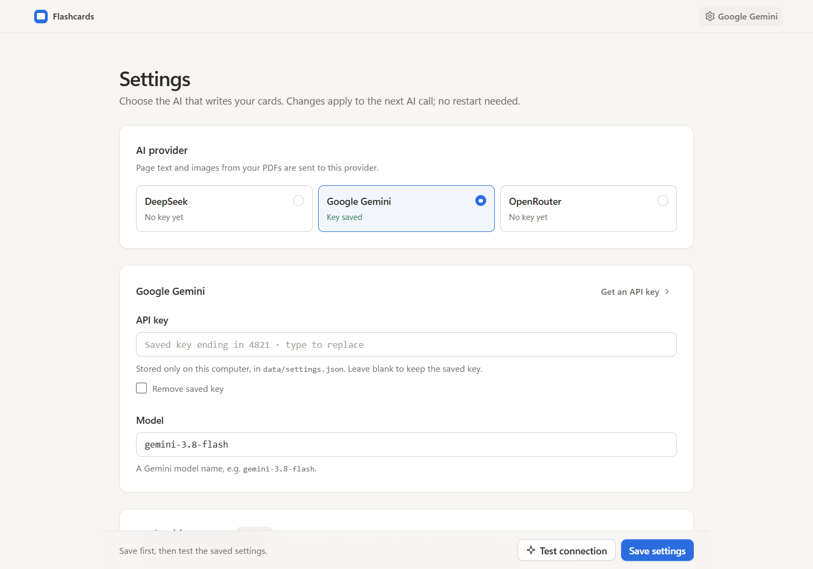
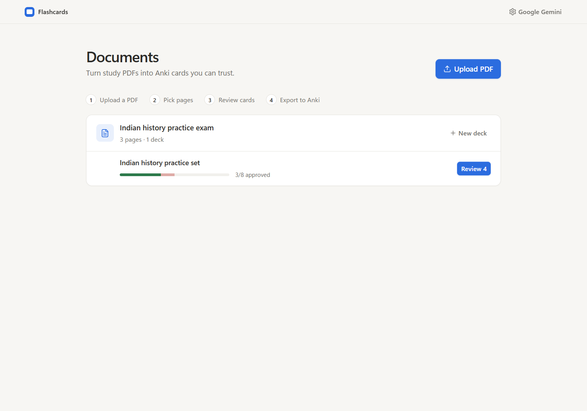
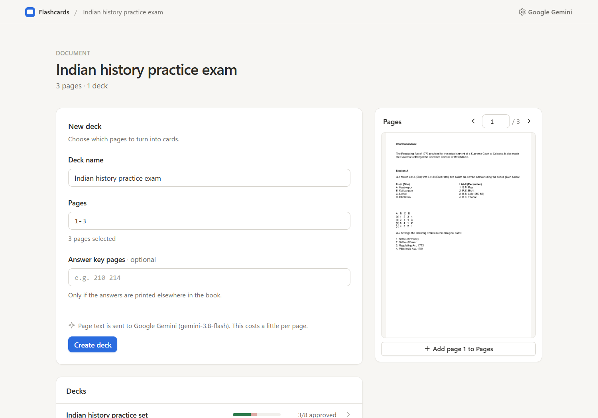
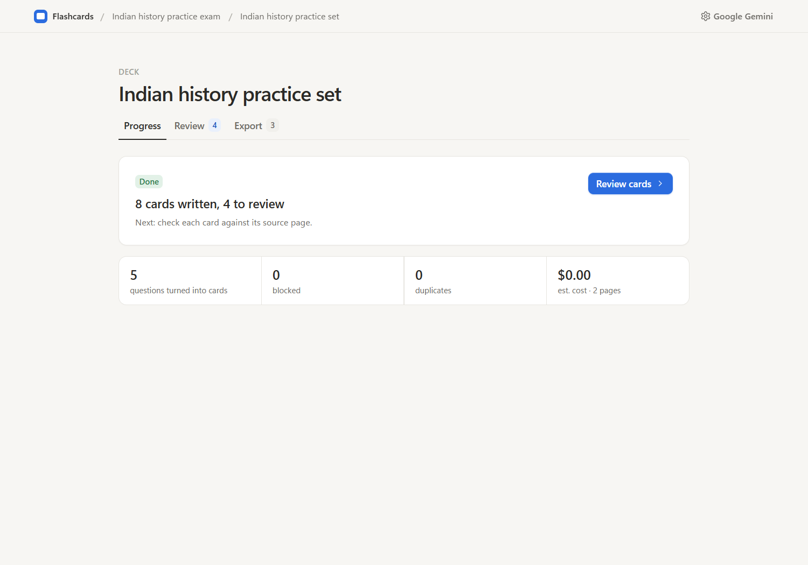
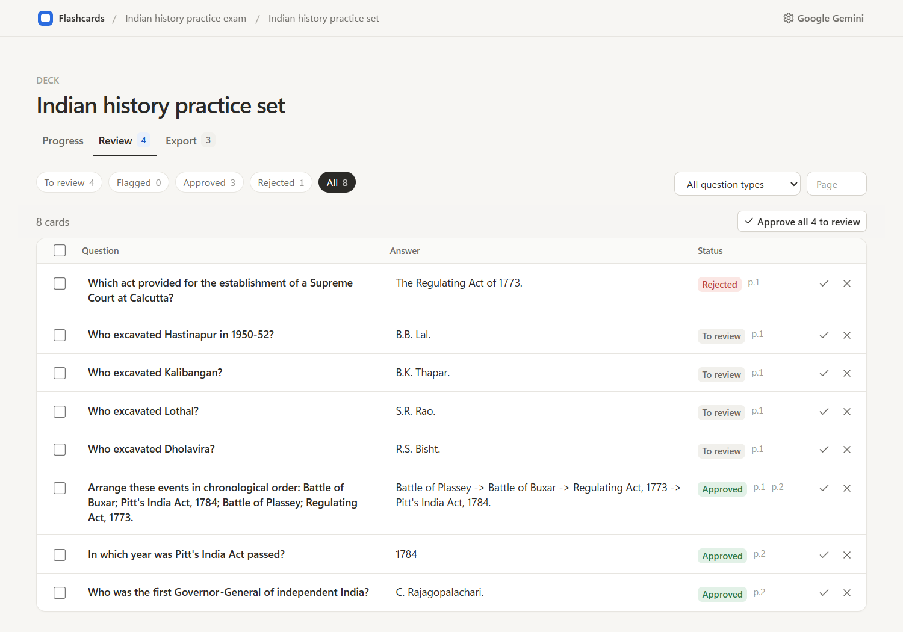
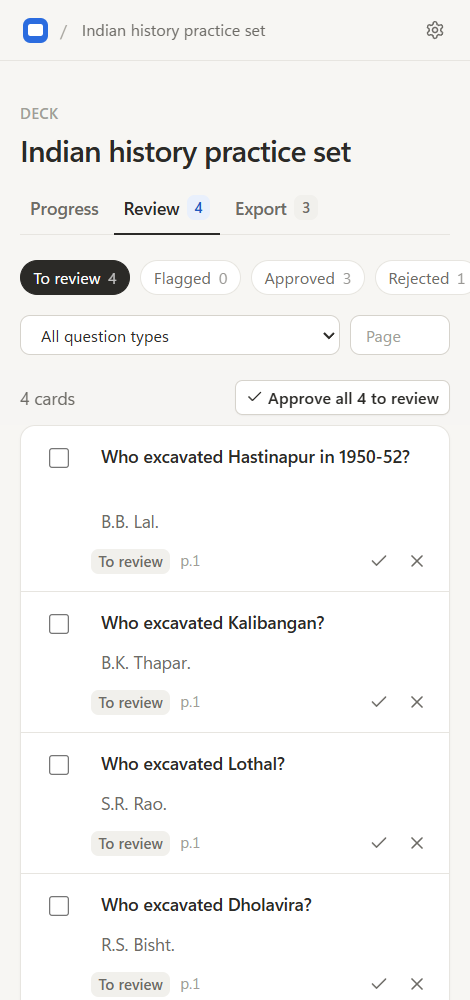
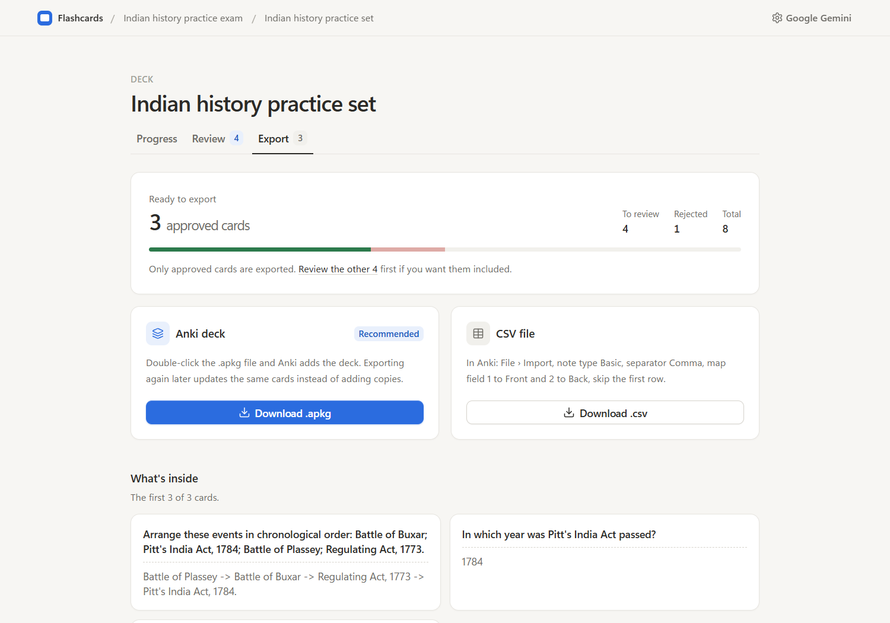

# PDF to Flashcards

Turns study PDFs into standalone question-and-answer cards and exports them for Anki
(`.apkg` deck file or `front,back` CSV). Runs on your own computer with Python and SQLite.

## Setup

1. Install [uv](https://docs.astral.sh/uv/).
2. In this folder, run `uv sync` to install the pinned dependencies.
3. Start the app (below), open **Settings** (top right), pick DeepSeek, Google Gemini or OpenRouter,
   and paste your API key. The app sends the text and images of the pages you select to that provider.
   You can also change the model and the card-writing prompt there. Keys are saved only on this
   computer, in `data/settings.json`. The `DEEPSEEK_API_KEY`, `GEMINI_API_KEY` and `OPENROUTER_API_KEY`
   environment variables still work if you prefer them.

## Run

```powershell
uv run python run.py
```

Open http://127.0.0.1:8501. The launcher starts the app and one background worker.
Closing the browser does not stop processing. Press Ctrl+C in the terminal to stop both.
Unfinished work resumes on the next launch.

Data lives in `data/` (set `STUDYTOOL_DATA_DIR` to move it). Use `STUDYTOOL_PORT` to change the port.

## Use

Screenshots below use the small sample PDF from `fixtures/`.

1. **Settings:** pick an AI provider, paste your API key and choose a model. You can also edit the
   prompt that writes the cards. Click **Test connection** to check the key works.

   

2. **Documents:** click **Upload PDF**, or drop a PDF anywhere on the page. Each document lists its
   decks with a progress bar and a button for the next step.

   

3. **New deck:** open a document, name the deck and enter the pages to use, e.g. `7-16, 22`.
   If the answers are printed elsewhere, add the answer-key pages. Use the page browser on the
   right to find pages; **Add page** puts the page you see into the Pages box. Start with 2-5 pages
   to check quality and cost.

   

4. **Progress:** watch the steps run. You can close the tab; work continues. Stop or resume here.
   Questions that made no cards are listed with the reason.

   

5. **Review:** edit any question or answer in place; edits save when you click away. Approve (✓) or
   reject (✕) one card, tick several and approve them together, or approve everything still to
   review. Filter by status, question type or page. Click a page number to open the source page.
   Flagged cards show their warning under the row.

   

   It works on a phone too:

   

6. **Export:** download an Anki deck file (`.apkg`) or a CSV. Both contain approved cards only.

   

## Import into Anki

**Anki deck file (recommended):** double-click the `.apkg` file, or use File > Import in Anki.
The cards arrive as Basic notes in a deck named after your deck title. Importing a newer
export of the same deck updates those cards instead of adding duplicates.

**CSV:**

1. File > Import, and choose the CSV.
2. Note type: **Basic**. Field separator: **Comma**.
3. Map field 1 to **Front** and field 2 to **Back**.
4. Skip the first row. It is the `front,back` header.

## Back up the database

Do not copy `studytool.db` while the app is running. Use the built-in backup instead,
which is safe while the worker is writing:

```powershell
uv run python -c "from studytool import db; db.backup(db.connect(), 'backup.db')"
```

## Notes

- The app listens on 127.0.0.1 only and has no login. Do not expose the port to a network.
- AI usage costs money and is rate-limited by the provider. If the account runs out of
  balance or quota, processing stops with a message saying so. Your finished cards stay
  reviewable and exportable offline.
- Token counts and costs shown in the app are estimates.
- Run the tests with `uv run pytest -q`.

## Folders

```
studytool/            the app's Python code
  web.py              web pages and the small JSON actions they call
  worker.py           background worker that runs processing jobs
  pipeline.py         the steps of a job: read pages, find questions, match answers, write cards
  extract.py          reads text and images from PDF pages
  segment.py          splits a page into questions (AI)
  link.py             matches questions to answer-key entries
  normalize.py        turns each question into checked facts
  generate.py         writes cards from those facts (AI, editable prompt)
  validate.py         flags cards that need a closer look
  ai.py               talks to DeepSeek, Gemini or OpenRouter
  settings.py         provider, key, model and prompt chosen on the Settings page
  cards.py, jobs.py, documents.py, export.py, db.py, schemas.py, config.py   data and helpers
  templates/          HTML pages (Jinja)
  static/             app.css, app.js and the Tailwind source (tailwind.in.css)
  migrations/         SQL that creates the database tables
tests/                automated tests (no network, no real API calls)
fixtures/             sample PDFs used by the tests
docs/screenshots/     the pictures in this README
data/                 your database, uploaded PDFs, page images, exports and settings.json
                      (created on first run, never committed)
run.py                starts the web app and the worker
app.py                old Streamlit screen (`run.py --streamlit`), kept until the new one is confirmed
package.json          only for rebuilding app.css with Tailwind (`npm run build:css`)
pyproject.toml, uv.lock   Python dependencies
```
